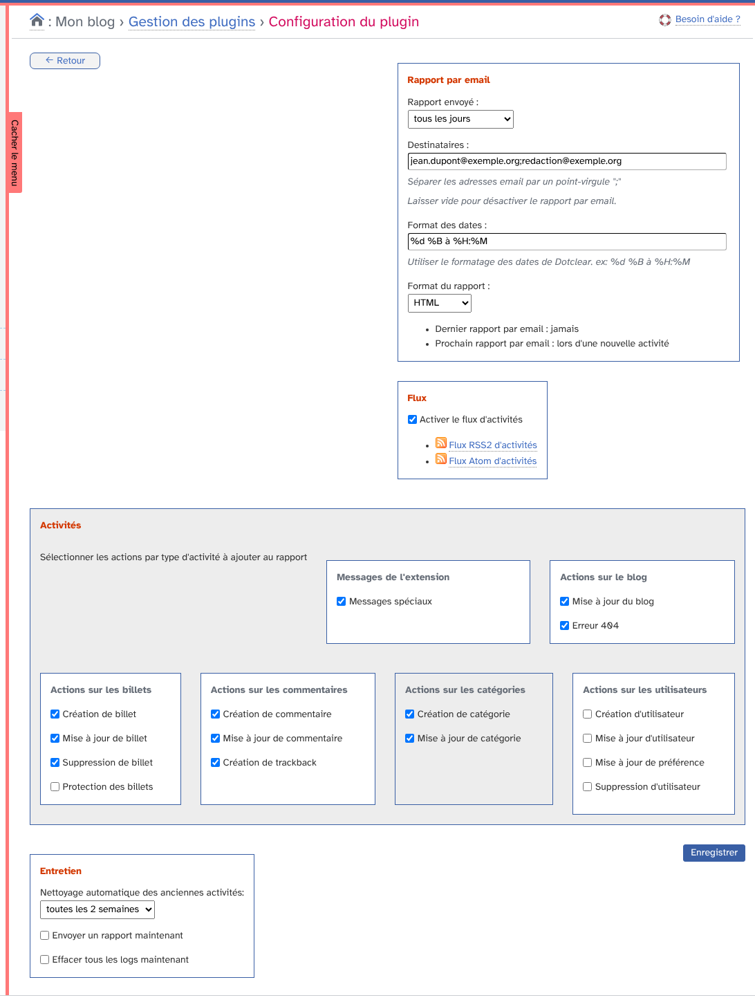
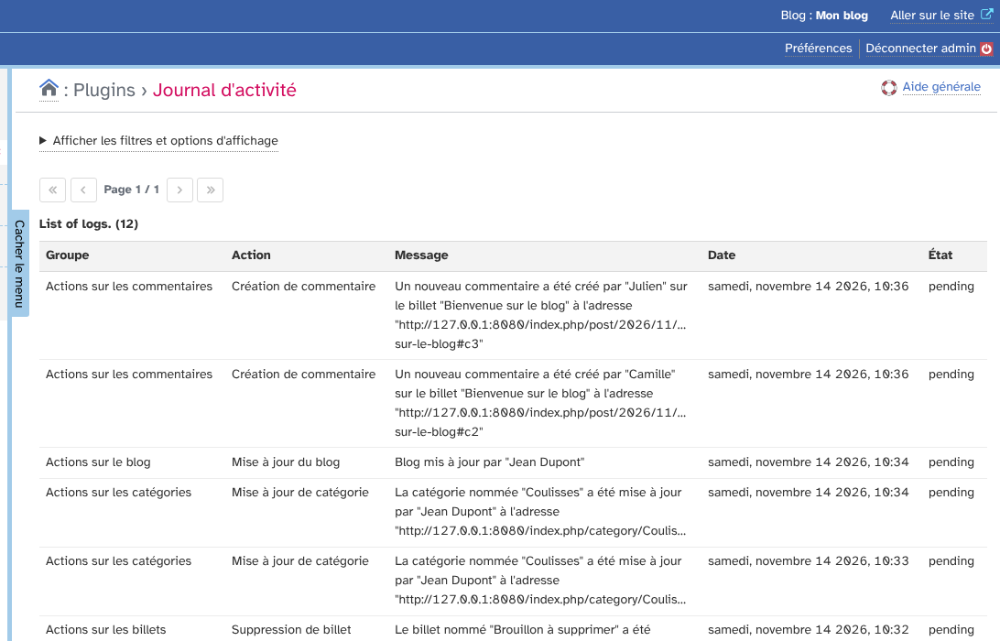
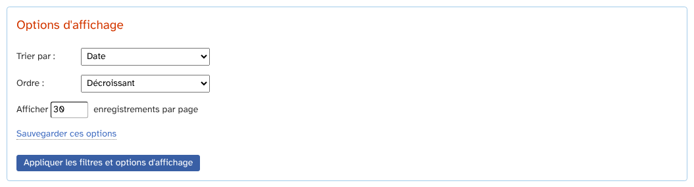
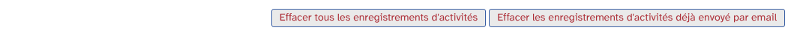
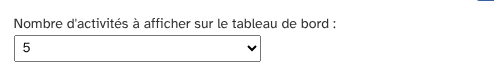
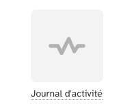
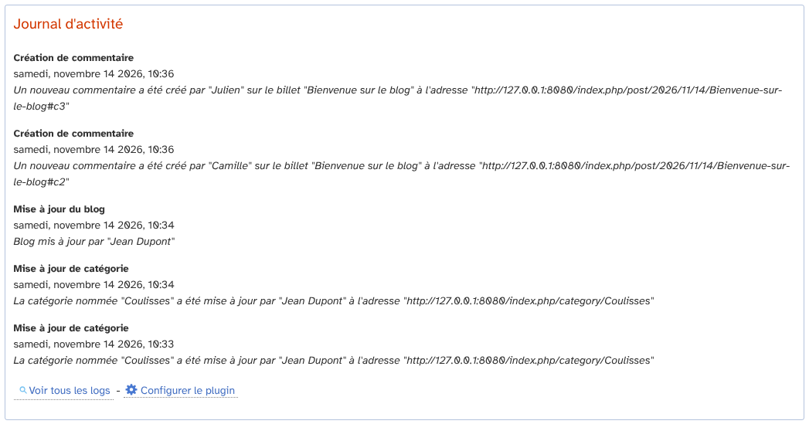
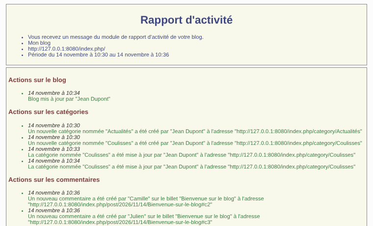
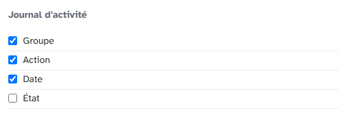
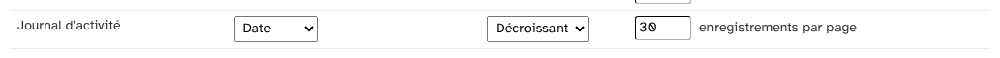

# Journal d'activité (activityReport) : guide d'utilisation

Ce guide explique comment suivre l'activité de votre blog Dotclear avec l'extension activityReport : elle enregistre ce qui se passe sur le blog (billets, commentaires, catégories…) et vous le présente dans une liste, sur le tableau de bord, par email ou dans un flux.

## Sommaire

1. [Configurer l'extension](#configurer-lextension)
2. [Consulter le journal](#consulter-le-journal)
3. [Voir l'activité sur le tableau de bord](#voir-lactivité-sur-le-tableau-de-bord)
4. [Recevoir un rapport par email](#recevoir-un-rapport-par-email)
5. [Suivre l'activité avec un flux](#suivre-lactivité-avec-un-flux)
6. [Entretenir le journal](#entretenir-le-journal)
7. [Préférences](#préférences)

## Configurer l'extension

Depuis **Plugins**, ouvrez l'extension et cliquez sur **Configurer le plugin**. Ce lien est aussi en bas de la page du journal.

La page contient quatre blocs.

* **Rapport par email** : la fréquence d'envoi, les destinataires, le format des dates et le format du rapport. Voir [Recevoir un rapport par email](#recevoir-un-rapport-par-email).
* **Flux** : l'activation des flux d'activités. Voir [Suivre l'activité avec un flux](#suivre-lactivité-avec-un-flux).
* **Activités** : les actions à enregistrer. Seules les cases cochées sont ajoutées au journal.
* **Entretien** : le nettoyage automatique et deux actions immédiates. Voir [Entretenir le journal](#entretenir-le-journal).

Les activités disponibles sont regroupées par type.

* **Messages de l'extension** : les messages spéciaux, par exemple l'envoi d'un rapport.
* **Actions sur le blog** : mise à jour du blog, erreur 404.
* **Actions sur les billets** : création, mise à jour, suppression et protection de billet.
* **Actions sur les commentaires** : création et mise à jour de commentaire, création de trackback.
* **Actions sur les catégories** : création et mise à jour de catégorie.
* **Actions sur les utilisateurs** : création, mise à jour et suppression d'utilisateur, mise à jour de préférence.

Cliquez sur **Enregistrer** pour valider.

## Consulter le journal

Ouvrez le menu **Plugins › Journal d'activité**.

Chaque ligne donne le groupe, l'action, le message, la date et l'état de l'enregistrement. Les plus récents sont en haut.

* « pending » : l'enregistrement n'a pas encore été envoyé dans un rapport par email.
* « reported » : il a été envoyé.

### Filtres

Le bloc « Afficher les filtres et options d'affichage » règle le tri (groupe, action, date, état), l'ordre et le nombre d'enregistrements par page.

### Effacer des enregistrements

Les deux boutons en bas de la liste effacent les enregistrements, après confirmation.

* **Effacer tous les enregistrements d'activités** : vide le journal.
* **Effacer les enregistrements d'activités déjà envoyé par email** : ne garde que ceux qui n'ont pas encore été rapportés.

## Voir l'activité sur le tableau de bord

Dans **Préférences › Mon tableau de bord**, vous pouvez :

* ajouter **Journal d'activité** à vos favoris, ce qui crée une icône sur le tableau de bord ;
* choisir le nombre d'activités affichées sur le tableau de bord.

Les choix sont : ne pas afficher le rapport d'activité, 5, 10, 15, 20, 50 ou 100 activités.

Le module affiche les dernières activités, avec un lien vers la liste complète et un lien vers la configuration.

## Recevoir un rapport par email

Le rapport est un message qui résume les activités enregistrées depuis le dernier envoi.

* **Rapport envoyé** : toutes les heures, 2 heures, 2 fois par jour, tous les jours, tous les 2 jours ou toutes les semaines.
* **Destinataires** : les adresses séparées par un point-virgule. Laissez vide pour désactiver le rapport par email.
* **Format des dates** : les formats de date de Dotclear, par exemple `%d %B à %H:%M`.
* **Format du rapport** : texte brut ou HTML.

Sous le formulaire, la date du dernier rapport et celle du prochain sont indiquées. Tant qu'aucun rapport n'a été envoyé, le prochain part « lors d'une nouvelle activité ».

Il n'y a pas de tâche planifiée : le rapport est envoyé quand une nouvelle activité est enregistrée et que le délai choisi est écoulé. Les enregistrements envoyés passent à l'état « reported ».

Si le serveur ne peut pas envoyer d'email, la page de configuration l'indique et aucun rapport n'est envoyé.

Pour envoyer un rapport tout de suite, cochez **Envoyer un rapport maintenant** dans le bloc Entretien puis enregistrez.

## Suivre l'activité avec un flux

Cochez **Activer le flux d'activités** puis enregistrez : deux liens apparaissent, **Flux RSS2 d'activités** et **Flux Atom d'activités**. Ajoutez-en un dans votre lecteur de flux.

L'adresse du flux contient une clé propre à votre compte. Gardez-la privée : toute personne qui la connaît peut lire le journal.

## Entretenir le journal

Le bloc **Entretien** de la configuration propose :

* **Nettoyage automatique des anciennes activités** : de toutes les heures à toutes les 4 semaines. Les enregistrements plus anciens que ce délai sont supprimés.
* **Envoyer un rapport maintenant** : à l'enregistrement du formulaire.
* **Effacer tous les logs maintenant** : à l'enregistrement du formulaire.

## Préférences

Dans **Préférences › Mes options**, le bloc « Journal d'activité » choisit les colonnes de la liste.

La ligne « Journal d'activité » des options des listes règle le tri et le nombre d'enregistrements par page.

